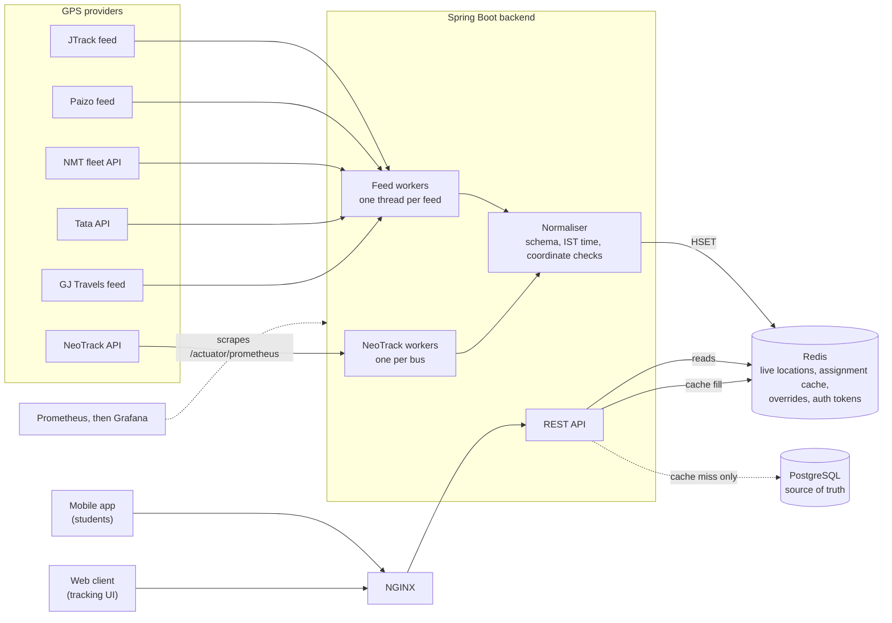
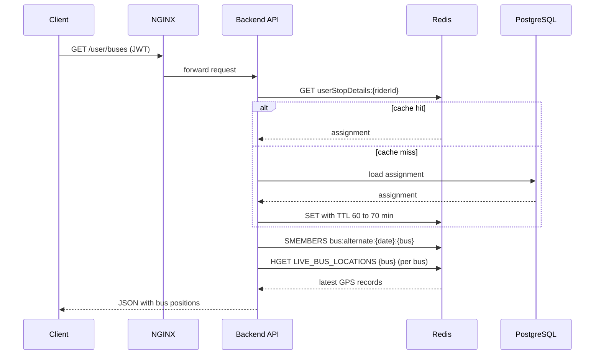
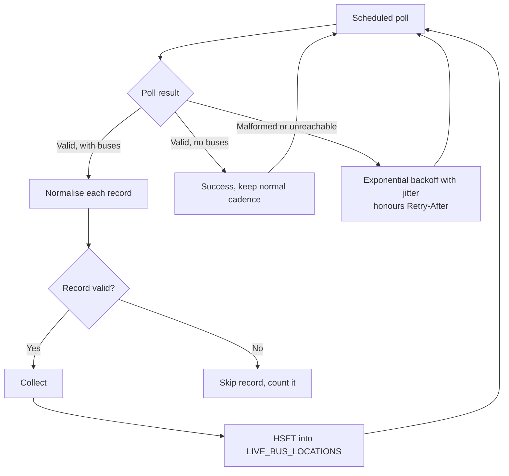

# Real-Time Bus Tracking Platform

**Official bus tracking system for SSN College of Engineering and Shiv Nadar University Chennai.**
Live at [bustracker.snuchennai.edu.in](http://bustracker.snuchennai.edu.in/). In production since 2025.

A real-time tracking backend that aggregates GPS data from several vendor feeds, normalises it into one format, and serves it to students and faculty through a Redis-backed live state store. Database work is kept off the location read path.

---

## Highlights

- **Six live GPS sources** (five vendor feeds and one NeoTrack feed) polled concurrently, each on its own thread
- **Single-lookup location reads** from Redis, with no database query on the location path
- **Read-through caching** of each rider's bus assignment, invalidated automatically when admins change data
- **Adaptive polling** that runs faster during the morning and evening peaks and slower off-peak, and respects each provider's rate limit
- **Fault isolation**: a failing provider, token or Redis call cannot stop the other feeds
- **Unified data model** across all vendor formats, with normalised registration numbers, IST timestamps and validated coordinates
- **Containerised deployment** with Prometheus metrics and Grafana dashboards

---

## System Architecture

---

## Request Flow: Live Location

Global view and guest requests skip the assignment lookup and read the whole hash with `HGETALL`. They never query the database.

---

## Data Ingestion

### Polling Schedule

| Window (IST) | Standard feeds | Once-per-minute APIs | NeoTrack (per bus) |
|---|---|---|---|
| Morning peak, 05:30 to 09:00 | every 5 s | every 65 s | every 10 s |
| Evening peak, 12:30 to 19:30 | every 5 s | every 65 s | every 10 s |
| Off-peak | every 15 min | every 15 min | every 15 min |

The schedule, poll intervals and backoff values are configurable through environment variables.

---

## Caching and Redis Data Model

| Key | Contents | Lifetime | Written by |
|---|---|---|---|
| `LIVE_BUS_LOCATIONS` | Hash: registration number to JSON location | 1 day, refreshed on write | Feed workers |
| `userStopDetails:{riderId}` | A rider's bus and stop assignment | About 1 hour, plus up to 10 min jitter | First request, read-through |
| `bus:alternate:{date}:{bus}` | Alternate buses for a date | Persistent until removed | Admin |
| `exam:dates`, `note:exam:{date}` | Exam days and notes | Persistent until removed | Admin |
| `ADMIN_TOGGLE` | Global view switch | Persistent | Admin |
| `NMT_TOKEN`, `API4_TOKEN` | Provider auth tokens | 7 days and 3500 min | Token refresh |

**Read-through cache.** A rider's assignment is loaded from PostgreSQL on the first request and cached in Redis. Each entry's expiry is jittered, so riders who logged in together do not all expire at once.

**Invalidation.** Any successful admin write clears all cached assignments. Reads with no database access are unaffected.

**Failure behaviour.** If Redis is unavailable when reading an assignment, the request falls back to PostgreSQL rather than failing.

---

## Reliability

- **Per-record isolation.** A malformed GPS record is skipped and counted. The rest of the batch is still published.
- **Worker containment.** Each worker catches its own errors, so an unexpected failure cannot end a thread. The worker retries with backoff.
- **Timeouts.** Provider calls use a 5 s connect timeout and a 10 s read timeout. Database connections fail after 5 s when the pool is exhausted.
- **Rate-limit compliance.** Providers that limit calls to one per minute are polled at 65 s. Retry-After headers are honoured.
- **Startup validation.** Missing provider configuration stops the application at startup with a clear message, rather than failing on every poll.
- **Credential handling.** Provider error messages are logged with query strings removed, so API keys and passwords do not appear in logs.

---

## Tech Stack

| Layer | Technology |
|---|---|
| Language and framework | Java 17, Spring Boot 3.5 |
| Live state and cache | Redis (Lettuce client) |
| Database | PostgreSQL, MyBatis, Flyway migrations |
| Authentication | JWT for riders and admins, Firebase Admin |
| Edge | NGINX |
| Containers | Docker, Docker Compose |
| Observability | Spring Boot Actuator, Micrometer, Prometheus, Grafana |

---

## Deployment and Operations

- Runs on-premise on campus infrastructure as a Docker Compose stack: backend, Redis, PostgreSQL, NGINX, Prometheus and Grafana.
- Prometheus scrapes `/actuator/prometheus` every 5 seconds. Grafana dashboards show feed health, poll latency and request metrics.
- Production deployment and environment configuration are maintained privately. The public container image is built from the Cradle compose setup.

---

## Known Limitations

- **Single backend instance.** Feed workers run inside each backend instance, so running several instances would poll each provider more than once. A leader lock is required before horizontal scaling.
- **Redis eviction policy.** The Redis `maxmemory-policy` is `allkeys-lru`, which could evict overrides and tokens under memory pressure. A `volatile-lru` policy, or persisting these keys, would prevent this.
- **Cache staleness.** Changes made directly in the database, bypassing the admin API, are not reflected in cached assignments until the entry expires (about 70 minutes at most).

---

## Roadmap

- Single-poller leader election, to allow multiple backend instances
- Per-provider health metrics and alerting rules in Prometheus
- Client-side ETag support so polling clients only receive changed buses
