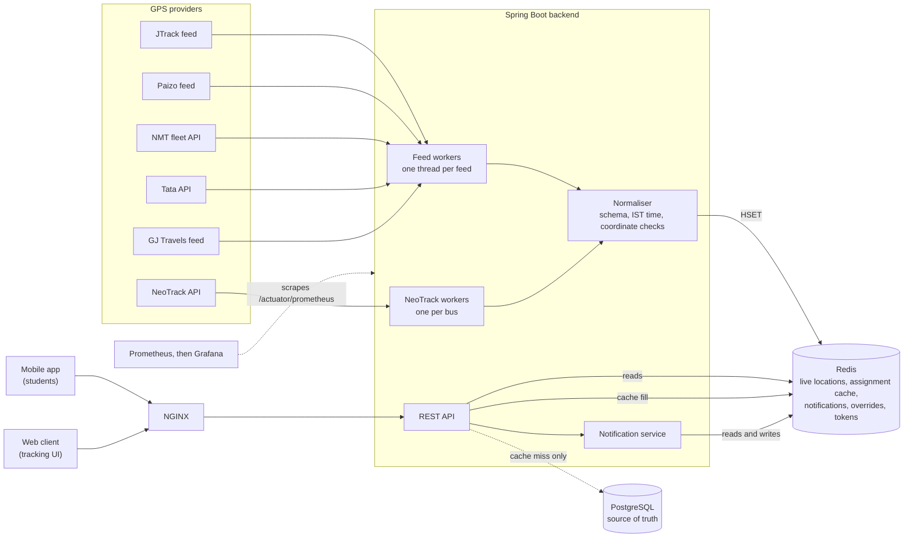
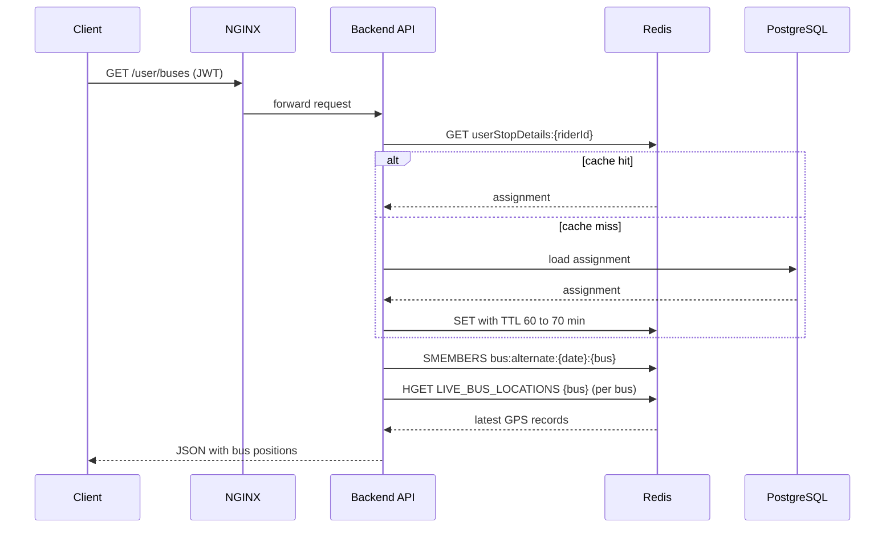
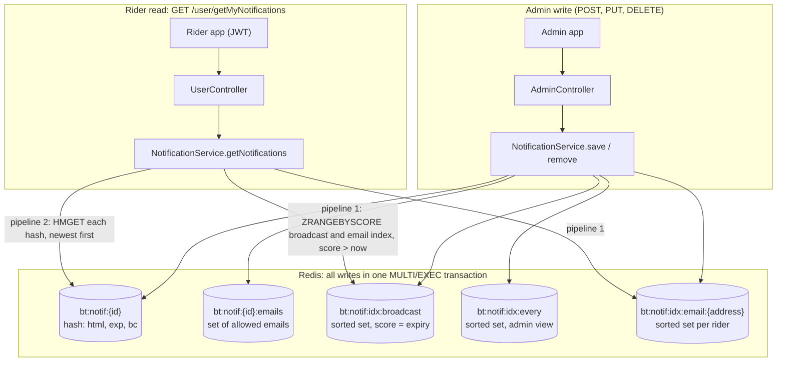
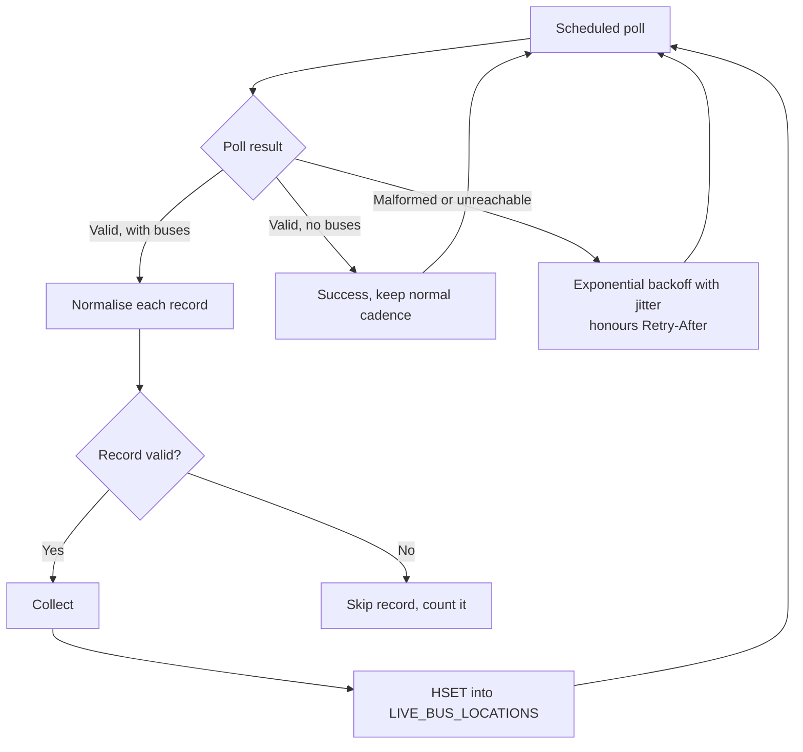
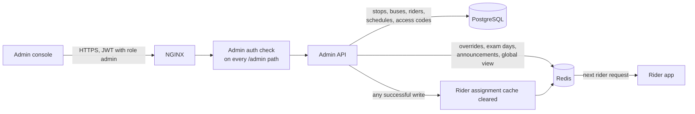

# Real-Time Bus Tracking Platform

**Official bus tracking system for SSN College of Engineering and Shiv Nadar University Chennai.**
Live at [bustracker.snuchennai.edu.in](https://bustracker.snuchennai.edu.in/). In production since 2025.

A real-time tracking backend. It collects GPS data from several vendor feeds, normalises it into one format, and serves it to students and faculty from a Redis-backed live state store. The location and notification read paths do not query the database.

---

## Highlights

- **Six live GPS sources** (five vendor feeds and multiple NeoTrack feed) polled concurrently, each on its own thread. (Neotrack-Purple has one thread per bus * 20 Buses)
- **Single-lookup location reads** from Redis, with no database query on the location path
- **Lazy loaded on demand caching** of each rider's bus assignment, invalidated automatically when admins change data
- **Redis-backed notifications** with per-rider, broadcast and expiring messages, served from indexed sorted sets
- **Adaptive polling** that runs faster during the morning and evening peaks and slower off-peak, within each provider's rate limit
- **Fault isolation**: a failing provider, token or Redis call cannot stop the other feeds
- **Unified data model** across all vendor formats, with normalised registration numbers, IST timestamps and validated coordinates
- **Containerised deployment** with Prometheus metrics and Grafana dashboards

---

## System Architecture

---

## Request Flow: Live Location

Global view and guest requests skip the assignment lookup and read the whole hash with `HGETALL`. They never query the database.

---

## Notifications

Admins publish notifications to every rider, to a list of named email addresses, or to everyone with an expiry time. Riders fetch their notifications from the API. The system is pull-based: nothing is pushed to devices, so a rider sees a notification the next time the app requests their list.

### Publishing and reading

### Design points

- **Expiry is enforced at read time, not by a sweeper.** Each index is a sorted set scored by the notification's expiry time, and reads request only scores above the current time. The Redis key also has an `EXPIREAT`, so the hash disappears on schedule. A notification with no expiry is scored at the year 3000.
- **Writes are atomic.** Creating, editing and deleting a notification each run as one Redis transaction, so a rider never sees a half-updated notification or an index that points to a missing hash.
- **Two round trips per read.** The indexes are queried in one pipeline, and then all matching hashes are fetched in a second pipeline. Results are ordered newest first, using time-ordered UUIDs (UUIDv7).
- **Edits re-index the message.** Changing the recipients removes the message from the old per-rider indexes and adds it to the new ones.
- **Email addresses are normalised.** They are trimmed and lower-cased before being stored or matched.
- **Validation.** Empty HTML and expiry times in the past are rejected.

### Redis keys

| Key | Type | Purpose |
|---|---|---|
| `bt:notif:{id}` | Hash | Message HTML, expiry time, broadcast flag |
| `bt:notif:{id}:emails` | Set | Recipients of a targeted notification |
| `bt:notif:idx:broadcast` | Sorted set | Unexpired broadcast notifications |
| `bt:notif:idx:every` | Sorted set | All unexpired notifications, for the admin list |
| `bt:notif:idx:email:{address}` | Sorted set | Unexpired notifications for one rider |

---

## Caching and Redis Data Model

| Key | Contents | Lifetime | Written by |
|---|---|---|---|
| `LIVE_BUS_LOCATIONS` | Hash: registration number to JSON location | 1 day, refreshed on write | Feed workers |
| `userStopDetails:{riderId}` | A rider's bus and stop assignment | About 1 hour, plus up to 10 min jitter | First request, read-through |
| `bus:alternate:{date}:{bus}` | Alternate buses for a date | Until removed | Admin |
| `exam:dates`, `note:exam:{date}` | Exam days and notes | Until removed | Admin |
| `ADMIN_TOGGLE` | Global view switch | Until changed | Admin |
| `NMT_TOKEN`, `API4_TOKEN` | Provider auth tokens | 7 days and 3500 min | Token refresh |
| `bt:notif:*` | Notifications and their indexes | Until expiry or deletion | Admin |

**Read-through cache.** A rider's assignment is loaded from PostgreSQL on the first request and cached in Redis. Each entry's expiry is jittered, so riders who logged in together do not all expire at once.

**Invalidation.** Any successful admin write clears all cached assignments. Reads that do not use the database are unaffected.

**Failure behaviour.** If Redis is unavailable when reading an assignment, the request falls back to PostgreSQL rather than failing.

---

## Reliability

- **Per-record isolation.** A malformed GPS record is skipped and counted. The rest of the batch is still published.
- **Worker containment.** Each worker catches its own errors, so an unexpected failure cannot end a thread. The worker retries with backoff.
- **Timeouts.** Provider calls use a 5 s connect timeout and a 10 s read timeout. Database connections fail after 5 s when the pool is exhausted.
- **Rate-limit compliance.** Providers that allow one call per minute are polled every 65 s. Retry-After headers are honoured.
- **Startup validation.** Missing provider configuration stops the application at startup with a clear message, rather than failing on every poll.
- **Credential handling.** Provider error messages are logged with query strings removed, so API keys and passwords do not appear in logs.

---

## Data Ingestion

### Polling Schedule

| Window (IST) | Standard feeds | Once-per-minute APIs | NeoTrack (per bus) |
|---|---|---|---|
| Morning peak, 05:30 to 09:00 | every 5 s | every 65 s | every 10 s |
| Evening peak, 12:30 to 19:30 | every 5 s | every 65 s | every 10 s |
| Off-peak | every 15 min | every 15 min | every 15 min |

The schedule, poll intervals and backoff values are configurable through environment variables.

---

## Tech Stack

| Layer | Technology |
|---|---|
| Language and framework | Java 17, Spring Boot 3.5 |
| Live state, cache and notifications | Redis (Lettuce client) |
| Database | PostgreSQL, MyBatis, Flyway migrations |
| Authentication | JWT for riders and admins, Firebase Admin |
| Identifiers | Time-ordered UUIDs (uuid-creator) |
| Edge | NGINX |
| Containers | Docker, Docker Compose |
| Observability | Spring Boot Actuator, Micrometer, Prometheus, Grafana |

---

## Deployment and Operations

- Runs on-premise on campus infrastructure as a Docker Compose stack: backend, Redis, PostgreSQL, NGINX, Prometheus and Grafana.
- Prometheus scrapes `/actuator/prometheus` every 5 seconds. Grafana dashboards show feed health, poll latency and request metrics.
- Production deployment and environment configuration are maintained privately. The public container image is built from the Cradle compose setup.

---

## Known Limitations

- **Single backend instance.** Feed workers run inside each backend instance, so running several instances would poll each provider more than once. A leader lock is required before horizontal scaling.
- **Redis eviction policy.** The Redis `maxmemory-policy` is `allkeys-lru`. Under memory pressure this can evict overrides, tokens and notifications. A `volatile-lru` policy, or persisting these keys, would prevent that.
- **Cache staleness.** Changes made directly in the database, bypassing the admin API, are not reflected in cached assignments until the entry expires (about 70 minutes at most).
- **Pull-based notifications.** Riders see a notification only when their app fetches the list. Push delivery is not implemented.
- **Stale email indexes.** Expired notifications are removed from the broadcast and admin indexes, but their per-rider indexes are only cleaned up when that rider's notifications are next edited. Those sorted sets can grow over time.
- **Email addresses in Redis keys.** Per-rider index keys contain plain email addresses. Restricting Redis access, or switching to a salted hash of the address, would reduce exposure.

---

## Admin Console

Administrators manage the whole system from a dedicated web console. The console covers the fleet and network data, rider and schedule management, live operations and announcements. Every admin request is authenticated.

### Feature Areas

| Area | What admins can do |
|---|---|
| **Live operations** | Monitor one bus or all buses in real time. Switch the global view on or off, which controls whether riders can see every bus. |
| **Exam and special days** | Mark exam days with notes, set a time window for the global view on those days, and remove them when they pass. |
| **Alternate buses** | Assign replacement buses for a bus on a given date, with a note for riders, and remove the override when it is no longer needed. |
| **Stops** | Create, edit, delete and look up stops with their names and coordinates. |
| **Buses** | Create, edit, delete and look up buses, and list the full fleet. |
| **Riders** | Create, edit, delete and look up riders, and list all riders. |
| **Schedules (profiles)** | Create and delete schedule profiles, switch them on or off, and assign buses, stops and riders to a profile. Profiles can also be bulk-imported from an Excel file. |
| **Registration mapping** | Maintain the link between bus registration numbers and vehicle records. |
| **Access codes** | Generate and revoke access codes for parent and guest logins, and review who has logged in with a guest or parent account. |
| **Announcements** | Publish notifications to all riders or to named email addresses, with an optional expiry time. Edit or remove them at any time. |

### How Admin Actions Reach Riders

- **Changes take effect quickly.** Overrides, exam days, the global view and announcements are stored in Redis, so they apply on the next rider request. The rider assignment cache is cleared after any successful admin write, so a new schedule or assignment is not hidden behind an hour-long cache entry.
- **The database holds the master records.** Stops, buses, riders, schedules and access codes are stored in PostgreSQL. Their changes are reflected in Redis through the same admin write path.
- **Access control is enforced per request.** Only accounts with the admin role can call admin endpoints, and rider or guest tokens are rejected there.
